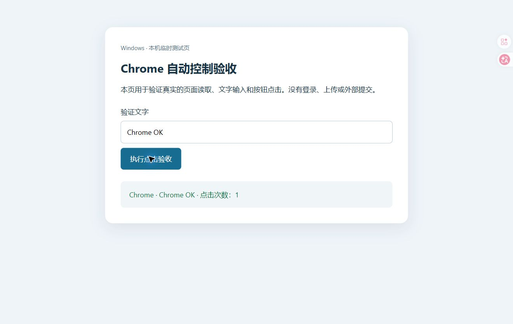
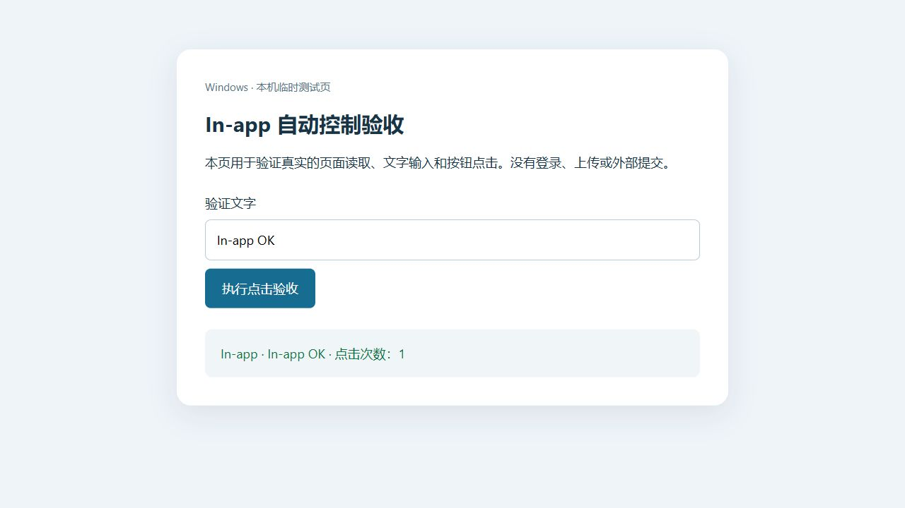

# BUG-001：网页能打开，但 Codex 浏览器自动控制始终不可用

记录日期：2026-10-12。平台：Windows。状态：本机处理后验收通过；官方修复状态未确认。

## 我遇到的问题

我在 Windows 上使用 Codex 的浏览器功能时，内置浏览器可以手动打开网页，包括 example.com 和百度 AI Studio。网页批注、选中元素和截图也能传到对话。

但只要让 Codex 自动读取或点击页面，就一直报：

```text
Browser is not available: iab
```

Chrome 自动控制同时报：

```text
Browser is not available: chrome
```

终端、Node 和文件读写正常。电脑控制服务能识别窗口，后来也在单独的记事本测试中完成了点击和输入。因此，当时不能简单理解成全部本地工具都失效。

我期望在手动浏览器正常、权限已经开启的情况下，自动控制能找到浏览器；如果某一步初始化失败，至少应提示具体原因。

## 当时的环境

| 项目 | 现场记录 |
|---|---|
| 桌面安装包 | OpenAI.Codex 26.1007.2314.0 |
| Browser 组件 | 26.1007.21434 |
| 数据存放 | D 盘物理目录 `D:\CodexData\.codex` |
| 原入口 | `%USERPROFILE%\.codex` 是指向上述目录的 Windows Junction |
| 网络 | Clash Verge/Mihomo，规则模式、TUN 开启，本机端口 7897 |

当时我为了把数据放到 D 盘，保留了默认 C 盘入口并建立目录连接。数据本身没有丢失，其他功能也能够正常使用。

## 触发条件与复现情况

我的现场条件是：工具运行环境的 `CODEX_HOME` 指向 Junction 入口，而不是 D 盘物理目录；在该环境中，通过官方 Browser API 获取 `iab` 或 `chrome`，两者都返回不可用，发现列表仅剩 MCP Apps。

这记录的是故障现场和修改后的对照结果。我没有在另一台干净电脑上重建安装，也没有为了复现重新破坏已经恢复的环境。是否所有 Junction 布局、其他版本也会触发同样问题，尚未验证。

## 尝试过但没有恢复的办法

- 更新应用，重启应用与电脑，使用新对话，添加浏览器入口。
- 先手动打开浏览器，再在新的工具会话中连接。
- 删除自动生成的运行配置；应用会重新生成，但自动控制仍不可用。
- 对两个代理节点进行短暂对照；设置接口都能返回 HTTP 200，但浏览器控制没有恢复，之后恢复原节点。
- 重新安装 Chrome 扩展；内置浏览器问题仍存在，Chrome 宿主也仍缺失，详见 BUG-002。

这些结果只能说明对应尝试没有解决我的问题。HTTP 200 不等于真实 WebSocket 会话成功；历史 `ECONNREFUSED` 也不能直接证明当前浏览器发现故障由网络引起。

通过本地连接端口与 Clash 记录匹配，已经确认部分 Codex 后台连接经过 TUN 与代理，因此“组件全部没有走代理”的判断不成立。

## 后来找到的直接证据

浏览器发现阶段的临时本地诊断捕获到：

```text
ConfigReadError: Browser Use could not read config.
| cause: Error: Codex TOML directory must not be a symlink
```

现场有 6 个候选通信端点；两个候选返回上面的配置读取错误，最终浏览器统计为 `iab: 0`、`extension: 0`、`mcpapps: 1`。脱敏记录见 [发现阶段证据](../evidence/discovery-before.sanitized.json)。

诊断表明：发现浏览器后还需要读取配置。入口目录的连接检查失败，使有效候选也被排除。这解释了为什么浏览器窗口正常，但工具仍说浏览器不可用。

其他候选也出现过会话路由错误。不过发现过程会探测多个端点，单个候选失败不足以证明整个会话路由坏了。早期把路由故障放在首位的判断不完整，后来并没有通过修改私有路由来解决问题。

临时诊断修改只用于记录错误，完成后已恢复原文件并核对 SHA256；没有降低目录检查或浏览器授权策略。

## 我这台电脑上的处理

我将工具运行配置中的 `CODEX_HOME`、Chrome 宿主索引的 `codexHome` 和用户环境变量指向实际存在的物理目录 `D:\CodexData\.codex`，随后重新打开桌面应用。

原 Junction 和 D 盘数据均保留，没有移动或删除聊天、登录信息、项目或数据库，也没有修改 WindowsApps 安装包。

`CODEX_HOME` 是官方文档列出的状态目录变量。文档要求目标目录已经存在，但这不等于官方承诺所有目录连接场景都受支持。参见 [Environment variables](https://learn.chatgpt.com/docs/config-file/environment-variables)。

Chrome 的独立宿主与插件问题也在同一轮处理，详见 [BUG-002](BUG-002-chrome-native-host.md)。由于多项修改顺序执行，没有逐项反向实验，不能声称 Chrome 恢复只依赖目录路径这一个改动。

## 实际验收结果

重新打开应用后，官方 Browser API 可以发现 Chrome 和内置浏览器。两者均打开并读取 example.com，然后在本机临时测试页中输入文字、点击按钮并读取点击回显。

| 功能 | Chrome | 内置浏览器 |
|---|---|---|
| 浏览器发现 | 通过 | 通过 |
| example.com 导航与页面读取 | 通过 | 通过 |
| 测试页文字输入 | Chrome OK | In-app OK |
| 按钮点击与回显 | 点击次数：1 | 点击次数：1 |
| 结果截图 | 已保存 | 已保存 |





[脱敏验收摘要](../evidence/acceptance.sanitized.json)保留了验收时间与结果。临时测试服务已停止。

验收过程中曾遇到临时单线程 HTTP 服务被空连接阻塞，换为并发服务后恢复；这是测试设施的问题，没有把当时的导航超时当成新的 Codex 根因。自动重启辅助程序也中断了当前工具连接，最后是我重新打开应用后完成验收，不能将辅助程序本身写成自动重启成功。

## 我希望产品改进的地方

我理解配置读取可能需要目录安全检查。但用户看到的错误应该明确说明哪个配置入口被拒绝，并给出受支持的数据目录设置方式。

目前泛化的 `Browser is not available` 把配置读取、发现和网络问题混在一起，让我花了不少时间尝试重启、换对话和网络对照。即使不能支持 Junction，也希望在初始化时直接指出原因，而不是等到自动控制时只显示浏览器不可用。

我的环境在 2026-10-12 验收时已经恢复；之后升级是否复发、其他环境是否相同，仍需要继续记录。
