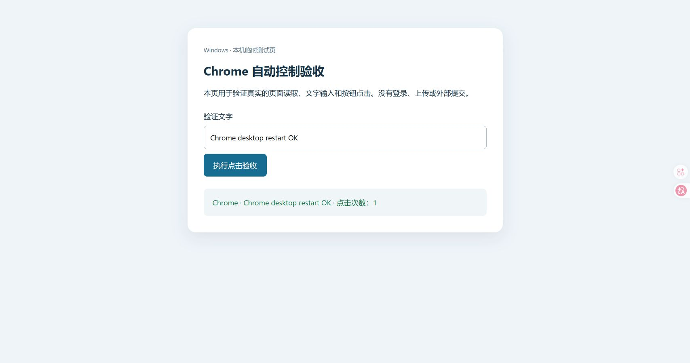

# BUG-008：应用更新后 Chrome 再次不可用，新版 Browser 缓存缺失且宿主索引仍引用旧程序

记录日期：2026-10-16。状态：本机已恢复；通信宿主冷启动及桌面应用完整重启后均通过操作验收。官方修复状态未确认。

2026-10-17 补充：上述验收针对本条的缓存和宿主问题。后来又出现“当前对话可用、其他对话无法加载浏览器功能配置”，已另记为 [BUG-009](BUG-009-browser-feature-gates-cross-chat.md)，仍然根因待确认；不能将本条状态理解为跨对话连接已全面修复。

## 我再次遇到的问题

10 月 12 日，我的 Chrome 和内置浏览器自动控制曾经恢复，并通过页面读取、输入和点击验收。10 月 16 日，我发现 Chrome 又无法连接。

这次我先对照了之前的记录，没有直接重做网络切换或旧修复。此前的 `CODEX_HOME` 物理路径设置仍然保留；Chrome 的 manifest、注册项及宿主进程也都存在。因此不能把这次复发简单归为之前完全相同的目录入口错误或宿主缺失。

我期望应用更新后，内置浏览器运行组件、插件缓存与通信宿主配置能保持一致，或者在初始化失败时指出缺失的组件。

## 环境和实际错误

| 项目 | 本次现场 |
|---|---|
| 桌面应用安装包 | OpenAI.Codex 26.1007.9446.0 |
| 上次验收时安装包 | OpenAI.Codex 26.1007.2314.0 |
| 当前运行环境要求的 Browser | 26.1007.71326 |
| 修复前仅有的旧 Browser 缓存 | 26.1007.21434 |
| 当前 CLI | 0.162.0-alpha.17.2 |
| CODEX_HOME | 仍指向 D 盘物理目录 |

官方 Browser 运行环境初始化直接报出找不到新版模块，以下路径已脱敏：

```text
Cannot find module '<CODEX_HOME>/plugins/cache/openai-bundled/browser/26.1007.71326/scripts/browser-service.mjs'
```

该错误发生在选择和操作 Chrome 之前，不能当作网站权限、页面加载或代理节点失败。

## 三类发现与证据边界

### 1. 新版 Browser 缓存缺失，是本次直接观察到的阻塞

配置要求新版 Browser，但磁盘没有对应版本目录。通过官方 CLI 补齐新版组件后，第一次重试仍保留原加载错误；刷新工具会话后，Chrome 可以连接并完成读取、输入和点击。

当时尚未修改旧宿主索引，因此这一步的对照支持“缺失的 Browser 组件直接阻塞初始化”。我没有证据证明是谁或哪一步更新过程漏掉缓存，也未在干净设备复现。

### 2. 原插件源路径在当前 CLI 中不可用

配置里的 bundled 插件源仍使用带扩展路径前缀的 C 盘 Junction 入口。官方 CLI 列举不到该源，直接安装报：

```text
plugin `browser` was not found in marketplace `openai-bundled`
```

仅用官方 CLI 的临时配置覆盖，将源改为 D 盘物理路径后，同一命令可以识别插件源并安装 Browser。之后将这一处 source 持久改为物理路径，列举也通过。

这证明旧写法在当前环境中不能正确使用；没有单独分离 Junction、扩展路径前缀及其他路径解析因素，不能将具体机制写成已经确认。

### 3. 两个宿主索引保留了失效旧路径，是另外的残留风险

两个 schemaVersion 2 的宿主索引仍引用旧 CLI、Node、node_repl 和旧 WindowsApps 资源目录；这些文件或目录已经不存在。manifest 正确不代表索引里的运行路径仍有效。

由于补齐 Browser 缓存后，在保留旧索引时 Chrome 就已恢复，这个残留不能被写成本次连接失败的唯一原因。但它不应继续留在下次宿主启动配置里。

## 我这台电脑上的处理过程

1. 备份配置、两个宿主索引、manifest、注册项和旧插件缓存。
2. 通过官方 CLI 从本机 bundled 插件源安装匹配的 Browser，修正插件源物理路径，完成第一轮操作验收。
3. 随后通过官方 CLI 将 Chrome 插件更新为 26.1007.71326。为避免运行中的宿主锁住缓存，短暂暂停这个宿主注册并停止对应宿主；安装结束恢复注册。
4. 在用户插件缓存中使用新版官方宿主安装程序生成 manifest 与启动配置，将两个宿主索引改为当前实际存在的 CLI、Node、node_repl、插件和资源路径，并更新相关标识及版本信息。
5. 检查两个索引中所有运行路径均存在，并确认宿主配置中的旧程序路径已经替换。
6. 旧宿主进程退出后，Chrome 启动了新的宿主进程。原控制句柄失效，新发现的 Chrome 端点可用；随后完成新的实际页面操作验收。

这是我授权进行的、有备份的本机维护，不是官方公布的通用修复方案。没有修改应用安装包、代理节点、TUN、证书验证、网站授权或浏览器安全检查，也没有把旧撤销脚本直接覆盖回去。

## 宿主重启后的实际验收

| 检查 | 实际结果 |
|---|---|
| 旧宿主退出、新宿主启动 | 已验证进程变化 |
| 使用新版官方宿主 | 缓存版本及宿主二进制检查通过 |
| 两个索引所有运行路径存在 | 通过 |
| 官方 manifest／注册诊断 | 通过 |
| Chrome 新连接发现 | 通过 |
| example.com 导航和读取 | 通过 |
| 本机测试页输入 | Chrome host restart OK |
| 按钮点击回显 | Chrome · Chrome host restart OK · 点击次数：1 |
| 默认视口截图 | 成功 |


[脱敏证据摘要](../evidence/browser-recurrence-2026-10-16.sanitized.json)仅保留版本、检查状态和验收结果，不上传原始索引、配置、聊天、进程命令行或备份。

第一轮验收曾遇到全页截图 5000ms 超时，随后默认视口截图成功；文字输入和按钮点击回显在超时前已经读取，不将这次截图失败隐去。

## 桌面应用完整重启验证

在独立重启辅助程序中，原桌面主进程已退出，新的桌面主进程已启动；应用重启中断了此前工具会话。应用重新打开后，我在新的工具会话中重新连接 Chrome，并独立完成了下列操作：

- 打开并读取 example.com。
- 在本机临时页输入 `Chrome desktop restart OK`。
- 点击验收按钮，读取回显 `Chrome · Chrome desktop restart OK · 点击次数：1`。
- 保存当前视口截图。
- 复核 CODEX_HOME 和插件源物理路径仍保留，两个索引不存在失效运行路径。



因此，“桌面应用重启后仍能连接和操作 Chrome”已经实测；没有将应用进程重新出现当成最终验收。Windows 整机重启尚未测试，不能把上述结果扩展为系统重启或未来更新的保证。

## 我希望改进的地方

希望更新后能自动检查：配置要求的 Browser 版本是否已落盘，bundled 插件源是否可解析，以及宿主索引中的程序和资源路径是否还存在。

若用户迁移了数据目录，希望所有相关组件都使用一致的物理路径；若不支持某种目录入口，也应提前给出明确提示。更重要的是，不能只以扩展“已安装”或 manifest 正确代表整条自动控制链路就绪。

## 与已有记录的关系

这是 [BUG-001](BUG-001-windows-browser-junction.md) 和 [BUG-002](BUG-002-chrome-native-host.md) 恢复后的同机复发记录。版本缓存缺失与旧宿主路径有新的直接证据，所以独立记录；并不代表在第二台设备复现，亦不代表官方已确认缺陷或修复。
