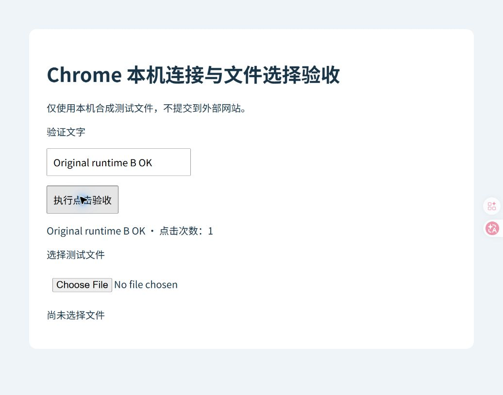

# BUG-009：当前对话能控制 Chrome，另一个或新对话却报“无法加载浏览器功能配置”

记录日期：2026-10-17。状态：间歇故障，根因待确认；已有两个对话的恢复证据，尚未完成同一轮跨对话稳定性验收。官方修复状态未确认。

## 我遇到的问题

在修复 Browser 版本缓存和旧宿主索引之后，我在当前排查对话里已经能读取 Chrome 页面、输入和点击。但切换到另一个或新对话时，仍然遇到：

```text
Unable to load browser feature gates. Retry the browser command.
```

界面将它描述为“无法加载浏览器功能配置”。有一次旧对话先经历文件选择等待超时和工具会话重置，随后连续初始化失败；另一个新对话也报了相同的功能配置错误。因此，不能把所有新对话失败都解释为前一次上传超时。

我期望同一台电脑上已连接的 Chrome 能在其他对话里可靠地重新连接。即使初始化暂时失败，也应指出失败阶段，并能通过正常重试恢复，而不是只给一个笼统错误。

## 版本和时间边界

| 项目 | 10 月 16 日失败现场 | 10 月 17 日复核现场 |
|---|---|---|
| Windows 安装包 | OpenAI.Codex 26.1007.9446.0 | OpenAI.Codex 26.1013.3656.0 |
| Browser / Chrome 组件 | 26.1007.71326 | 26.1013.31256 |
| CODEX_HOME | D 盘物理目录 | 仍为 D 盘物理目录 |
| 功能配置错误 | 两个对话有实际失败记录 | 本轮未再次复现 |

版本已经变化。本轮成功不能证明此前错误被某个版本正式修复，也不能反过来把旧版本现场与现在完全等同。

## 本轮查明的失败环节

对本机运行组件的只读分析表明：这个具体错误在功能配置初始化结果不成功，或配置客户端尚未达到 `Ready` 时抛出。实际配置请求使用 `ab.chatgpt.com/v1`。它与之前“找不到 Browser 模块”、宿主 manifest 缺失、旧浏览器连接编号失效是不同的错误阶段。

初始化状态和待完成的请求保存在各运行组件实例中；身份信息加载后还会更新配置。因此，已有成功状态的工具会话与刚启动的工具会话可能表现不同。重建工具会话会产生新的初始化机会。

这给“同机不同对话表现不同”提供了机制上的解释，但尚未证明失败那一次由什么触发。网络延迟、远端响应、身份更新时序或失败状态复用，仍需要失败现场的请求结果来区分。不能把“存在并发初始化”直接写成已确认的竞争缺陷。

## 实际请求取证

本轮临时在用户插件缓存的真实配置请求出口记录了白名单字段：时间、地址的主机与路径、HTTP 状态、内容类型、耗时和初始化结果。不记录认证头、请求体、响应正文、身份或功能开关值；未替换响应、改变开关判断或延长超时。

- 共观察到 10 个真实 `initialize` 请求，其中 8 个 HTTP 200，2 个 HTTP 204。
- HTTP 200 响应为 JSON，耗时 1327–3145ms。
- 两轮完整结果记录先出现 `User changed during update` 和 `Loading`，随后身份更新成功并进入 `Ready`。
- 后续一个 HTTP 204 请求也对应更新成功、状态 `Ready`。因此不能把 204 或一次初始结果为 false 单独视为故障。
- 本段采样未观察到配置请求的 HTTP 403 或传输异常；它不能排除历史现场出现过网络问题。

特别是 `User changed during update`：在本轮成功流程中也会出现。只截取这条中间结果，会把正常的身份更新取消误判成根因。

临时诊断会影响少量执行时序，所以我没有只凭带记录的测试下结论。取证后已恢复原始文件，SHA256 与备份一致，并重建工具会话完成下面两轮验收。没有把诊断代码作为修复留在插件里，也没有上传应用源码。

## 验收结果与边界

| 验证 | 结果 | 能证明什么 |
|---|---|---|
| 4 轮诊断初始化 | 均完成连接选择；其中一轮还完成本机页面读取、输入、点击 | 当前环境可以多次初始化；连接选择本身不等于完整操作验收 |
| 恢复原始组件后，独立工具会话 A | 读取、输入、点击通过 | 无临时诊断改动也能操作 |
| 再重建工具会话 B | 读取、输入、点击再次通过 | 当前对话中多次新工具会话可用 |
| 官方 Chrome 宿主 manifest 检查 | `correct: true` | 当前 manifest 与注册匹配；不替代页面验收 |
| 回看原来失败的另一个对话 | 10 月 16 日重建工具会话后实际读取页面并继续操作约 13 分钟 | 它并非永久无法连接；这是历史恢复证据 |
| 今天在多个不同对话间切换并重复操作 | 未执行 | 不得宣称跨对话稳定性已通过 |
| 今天的完整应用或 Windows 重启 | 未执行 | 不得宣称本条问题已通过系统冷启动验收 |

另一个对话的该轮记录包含 57 次 Node 工具调用，54 次完成、3 次失败。这些调用包括初始化和辅助操作，不能写成“54 次浏览器功能全部成功”。它只能辅助说明连接恢复后确实持续工作过。



本次没有向其他对话发送消息或操作其中的工作页面。需要我亲自切换或重新发起请求的跨对话验证先保留，避免打断正在进行的其他工作。

## 当前处理状态

我保留此前已经验证有效的物理路径设置，没有重复删除生成配置、重装宿主或切换代理节点。当前官方宿主检查和真实页面操作都通过，本轮没有证据支持再做这些全局改动。

本轮完成的是失败层级定位、真实初始化取证、原始组件恢复和重复操作验收，**没有实施能够证实消除该间歇故障的永久修复**。状态继续记为“根因待确认”，不以一次或多次当前对话成功代替跨对话验证。

下一次需要同时保留：失败对话的首个错误、实际初始化耗时、身份更新结果和最终 `Ready` 状态；随后只重建该对话自己的工具会话，与另一个对话做同一时间段的最小读取/输入/点击对照。取证应避免保留认证内容或业务页面数据。

## 与其他记录的关系

[BUG-008](BUG-008-browser-update-cache-host-index.md) 的缓存缺失和旧索引有直接证据及重启后验收。本条记录的是它恢复后出现的功能配置初始化问题，不能将 BUG-008 的“本机恢复”扩展成所有跨对话问题都解决了。

[脱敏证据摘要](../evidence/browser-feature-gates-2026-10-17.sanitized.json)保留本轮统计与验收边界。官方[排查说明](https://learn.chatgpt.com/docs/reference/troubleshooting)和 [Chrome 扩展说明](https://learn.chatgpt.com/docs/chrome-extension)用于核对正常工作流程；没有找到能够直接确认本条根因的官方修复说明。
